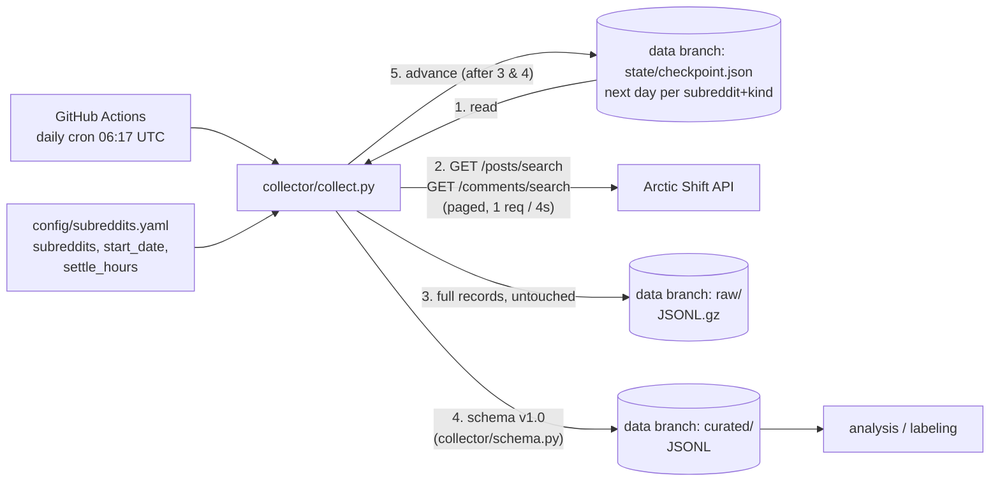

# Ozempic Reddit data pipeline

Automated daily collection of posts and comments from GLP-1 subreddits (task 2.1),
normalized into a fixed schema.

## How it works



Each run, for every `(kind, subreddit)`:

1. Read the checkpoint: the next UTC day to collect (or `start_date` the first time).
2. Pick the days that are **finished and settled**: the day ended at least `settle_hours` (72h) ago.
   Arctic Shift captures items within minutes of posting and re-captures them 36–61h later,
   so waiting 72h means `score`/`num_comments` are the refreshed values, not ~0.
   At most `max_days_per_run` days are done per run, so a long backfill spreads across runs.
3. For each day, page through the API (`sort=asc`, 100 items per page) for `[00:00, 24:00)` UTC.
4. Write that day's raw records and curated records, then advance the checkpoint by one day.

Days are taken from whichever `(kind, subreddit)` is furthest behind, one day at a time, so a run
cut short by its time budget still advances all streams evenly.

Because every day maps to fixed file paths, a crash or a re-run overwrites the same files:
no duplicates and no gaps.

The scheduled workflow stores everything on the repository's `data` branch
(created automatically on the first run, separate from the code):

```text
data branch/
├── raw/{posts|comments}/subreddit=Ozempic/date=2026-10-05.jsonl.gz    # exactly what the API returned
├── curated/{posts|comments}/subreddit=Ozempic/date=2026-10-05.jsonl   # schema v1.0 + ingested_at, one JSON record per line
├── exports/ozempic_100k_comments.csv                                  # see below
└── state/checkpoint.json                                              # {"posts/Ozempic": "2026-10-08", ...}
```

Curated files are JSON Lines because `config/subreddits.yaml` sets `curated_format: jsonl`;
set it to `parquet` to write Parquet instead. `--dest` also accepts an `s3://bucket/prefix`
URI if the data later moves to S3.

## Data schema (v1.0)

JSON Schemas: [schema/post.schema.json](schema/post.schema.json),
[schema/comment.schema.json](schema/comment.schema.json). The transform is in
[collector/schema.py](collector/schema.py), and the collector and the converter script both use it.

| | post | comment |
|---|---|---|
| identity | `id`, `fullname` (`t3_…`), `subreddit`, `author` | `id`, `fullname` (`t1_…`), `subreddit`, `author` |
| time | `created_utc`, `created_at`, `edited_utc`, `retrieved_utc` | same |
| text | `title`, `body`, **`text`** (title + body) | `body`, **`text`** |
| thread | `num_comments` | `post_id` → post `fullname`, `parent_id`, `is_top_level`, `is_submitter` |
| engagement | `score`, `upvote_ratio` | `score`, `controversiality` |
| moderation | `is_removed`, `removed_by`, `over_18`, `flair` | `is_removed` |
| provenance | `schema_version`, `type`, `source`, `permalink`, `url`, `is_self` | `schema_version`, `type`, `source`, `permalink` |

Conventions: deleted authors become `null`; `[removed]`/`[deleted]` bodies become `null`, with
`is_removed: true` and `text: ""`. `text` is the field to run NLP on.
Join comments to posts with `comment.post_id == post.fullname`.

## Collected data

Everything the workflow collects lives on the **`data` branch**; `main` holds only code.
Snapshot on 2026-10-28 (comments are collected through 2024-04-08 so far); the `data` branch's own
README.md is regenerated after every run with current numbers:

| | rows | by subreddit | days covered |
|---|---:|---|---|
| comments | 451,883 | Zepbound 162k · Mounjaro 114k · Semaglutide 86k · Ozempic 79k · tirzepatidecompound 9k · compoundedsemaglutide 1k | 2024-01-01 → 2024-04-08 |
| posts | 141,493 | Zepbound 44k · Mounjaro 34k · Semaglutide 34k · Ozempic 24k · tirzepatidecompound 4.6k · compoundedsemaglutide 0.1k | 2024-01-01 → 2024-06-29 … 2025-03-26, depending on subreddit |
| Ozempic export | 14,563 | comments from any subreddit mentioning "ozempic" | 2024-01-01 → 2024-04-08 |

Each run collects about 5 hours' worth (roughly 130–190 days of comments across all six
subreddits) and always continues with the subreddit that is furthest behind, so comments are
catching up with posts. `state/checkpoint.json` shows the next day to collect per stream, and each
data commit message names the oldest one (`Collect data (oldest next day: 2024-04-08)`).

### Which files to use

| path | contents | use it for |
|---|---|---|
| `curated/comments/subreddit=<name>/date=<YYYY-MM-DD>.jsonl` | one comment per line, [schema v1.0](#data-schema-v10) | analysis; `text` is the field for NLP |
| `curated/posts/subreddit=<name>/date=<YYYY-MM-DD>.jsonl` | one post per line, schema v1.0 | analysis; join comments with `post_id == fullname` |
| `exports/ozempic_100k_comments.csv` | up to 100,000 most recent comments mentioning "ozempic": `comment_id, subreddit, author, body, score, created_at, permalink` | opening in Excel/Google Sheets, labeling |
| `raw/…/*.jsonl.gz` | the API response, unchanged | re-deriving fields the schema leaves out |
| `state/checkpoint.json` | next day to collect per stream | checking progress |

The CSV `body` field can contain line breaks, so count rows with a CSV reader, not `wc -l`.

### Getting the data

Browse it on GitHub by switching the branch selector to `data`, or check it out next to the code:

```bash
git fetch origin data
git worktree add data origin/data    # ./data is git-ignored on main
git -C data pull                     # later, to get new days
```

Load it in Python:

```python
import glob
import pandas as pd

comments = pd.concat(
    pd.read_json(f, lines=True) for f in glob.glob("data/curated/comments/subreddit=*/*.jsonl")
)
ozempic = pd.read_csv("data/exports/ozempic_100k_comments.csv")
```

### Team copies

After every run the workflow pushes the same `data` branch to the team repositories
[adele-kha/uitbreiden_drug_experience](https://github.com/adele-kha/uitbreiden_drug_experience/tree/data)
and [UitbreidenAI/drug-exp-api](https://github.com/UitbreidenAI/drug-exp-api/tree/data), so all three
are identical. The code is kept on their `research-data-reddit` branches. Pushing there needs the
`TEAM_REPO_TOKEN` secret (see the GitHub Actions setup below); without it the copy step is skipped.

### Size

The branch is about 870 MB on disk (271 MB as stored by GitHub) for roughly 100 days of comments;
curated JSONL is most of it. A full backfill to 2026 would be about ten times that, past GitHub's
recommended 1 GB. Setting `curated_format: parquet` in `config/subreddits.yaml` writes Parquet
instead, typically 5–10× smaller, and the export script reads either format.

## Converting raw data you already have

```bash
python scripts/raw_to_schema.py path/to/raw_dir_or_files --out data/share --csv --validate
```

This accepts `.jsonl`, `.ndjson`, `.json` (array or `{"data": [...]}`), plain or `.gz`/`.zst`
compressed (Arctic Shift/Pushshift dump downloads). It writes `posts.jsonl`, `comments.jsonl`
and, with `--csv`, CSV copies that open directly in Google Sheets.

## Running

```bash
python3 -m venv .venv && source .venv/bin/activate   # keeps global packages out of the way
pip install -r requirements.txt
python -m collector.collect --dest data          # local test run, writes to ./data
python -m pytest tests
```

## Exporting up to 100,000 Ozempic comments

The scheduled GitHub Actions workflow writes a refreshed CSV to
`exports/ozempic_100k_comments.csv` on the `data` branch after each collection.
It contains the latest matching comments (case-insensitive mention of
`ozempic`), up to 100,000 rows. The daily collector continues adding data;
the export rolls forward to include the newest matches.

To generate the same export from local curated data:

```bash
python scripts/extract_ozempic_comments.py
```

By default this reads `data/curated/comments/` (Parquet or JSONL) and writes
`ozempic_100k_comments.csv`. The export contains up to 100,000 records; it may
contain fewer until enough matching data has been collected. The daily collector
continues to add data independently. Override paths or the cap with `--input`,
`--output`, and `--limit`.

GitHub Actions setup ([.github/workflows/collect.yml](.github/workflows/collect.yml)): collection
needs no secrets. The workflow pushes to the `data` branch with the built-in `GITHUB_TOKEN`
(`permissions: contents: write`). Copying to the [team repositories](#team-copies) needs a
`TEAM_REPO_TOKEN` secret: a classic personal access token with the `repo` scope from an account
that can push to them. When it expires, only the copy step fails; collection continues. Start a run by hand from the **Actions** tab → **Collect Reddit data**
→ **Run workflow**; tick **mirror_only** to skip collection and only test the copy
to the team repositories (about a minute). A long backfill is spread across runs: the collector
stops starting new days after 5 hours (Collect step capped at 345 minutes, job at the 360-minute GitHub maximum), and the next run continues from the checkpoint.

## Arctic Shift API notes (measured 2026-10-11)

- Requests without a browser-like or custom `User-Agent` get **403** from Cloudflare.
- `after` and `before` are both **exclusive**.
- About 20 requests/min trips **422 `"Timeout. Maybe slow down a bit"`**, followed by a multi-minute
  block (`x-ratelimit-reset-at` moves ahead). The collector sends 1 request per 4s (3s still tripped blocks on long runs), waits for `reset-at`,
  and if a request still fails after 20 minutes, pauses 30 minutes and retries the same day.
- Volume (Oct 2026): roughly 6–120 posts/day per subreddit; comments up to ~2,000/day (r/Zepbound).
  One day of all 6 configured subreddits is about 50 requests, an estimated 3–4 minutes.
