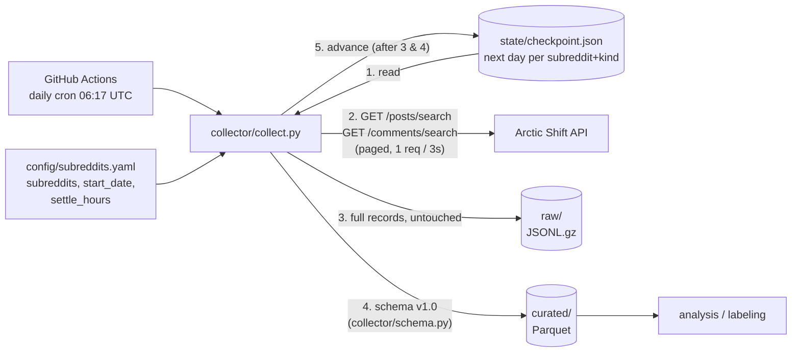

# Ozempic Reddit data pipeline

Automated daily collection of posts and comments from GLP-1 subreddits (task 2.1),
normalized into a fixed schema.

## How it works



Each run, for every `(kind, subreddit)`:

1. Read the checkpoint: the next UTC day to collect (or `start_date` the first time).
2. Pick the days that are **finished and settled**: the day ended at least `settle_hours` (72h) ago.
   Arctic Shift captures items within minutes of posting and re-captures them 36–61h later,
   so waiting 72h means `score`/`num_comments` are the refreshed values, not ~0.
   At most `max_days_per_run` days are done per run, so a long backfill spreads across runs.
3. For each day, page through the API (`sort=asc`, 100 items per page) for `[00:00, 24:00)` UTC.
4. Write that day's raw records and curated records, then advance the checkpoint by one day.

Because every day maps to fixed file paths, a crash or a re-run overwrites the same files:
no duplicates and no gaps.

```text
s3://<bucket>/reddit/
├── raw/{posts|comments}/subreddit=Ozempic/date=2026-10-05.jsonl.gz      # exactly what the API returned
├── curated/{posts|comments}/subreddit=Ozempic/date=2026-10-05.parquet   # schema v1.0 + ingested_at
└── state/checkpoint.json                                                # {"posts/Ozempic": "2026-10-08", ...}
```

## Data schema (v1.0)

JSON Schemas: [schema/post.schema.json](schema/post.schema.json),
[schema/comment.schema.json](schema/comment.schema.json). The transform is in
[collector/schema.py](collector/schema.py), and the collector and the converter script both use it.

| | post | comment |
|---|---|---|
| identity | `id`, `fullname` (`t3_…`), `subreddit`, `author` | `id`, `fullname` (`t1_…`), `subreddit`, `author` |
| time | `created_utc`, `created_at`, `edited_utc`, `retrieved_utc` | same |
| text | `title`, `body`, **`text`** (title + body) | `body`, **`text`** |
| thread | `num_comments` | `post_id` → post `fullname`, `parent_id`, `is_top_level`, `is_submitter` |
| engagement | `score`, `upvote_ratio` | `score`, `controversiality` |
| moderation | `is_removed`, `removed_by`, `over_18`, `flair` | `is_removed` |
| provenance | `schema_version`, `type`, `source`, `permalink`, `url`, `is_self` | `schema_version`, `type`, `source`, `permalink` |

Conventions: deleted authors become `null`; `[removed]`/`[deleted]` bodies become `null`, with
`is_removed: true` and `text: ""`. `text` is the field to run NLP on.
Join comments to posts with `comment.post_id == post.fullname`.

## Converting raw data you already have

```bash
python scripts/raw_to_schema.py path/to/raw_dir_or_files --out data/share --csv --validate
```

This accepts `.jsonl`, `.ndjson`, `.json` (array or `{"data": [...]}`), plain or `.gz`/`.zst`
compressed (Arctic Shift/Pushshift dump downloads). It writes `posts.jsonl`, `comments.jsonl`
and, with `--csv`, CSV copies that open directly in Google Sheets.

## Running

```bash
pip install -r requirements.txt
python -m collector.collect --dest data          # local test run, writes to ./data
python -m pytest tests
```

## Exporting up to 100,000 Ozempic comments

The scheduled GitHub Actions workflow writes a refreshed CSV to
`s3://<bucket>/reddit/exports/ozempic_100k_comments.csv` after each collection.
It contains the latest matching comments (case-insensitive mention of
`ozempic`), up to 100,000 rows. The daily collector continues adding data;
the export rolls forward to include the newest matches.

To generate the same export from local curated Parquet data:

```bash
python scripts/extract_ozempic_comments.py
```

By default this reads `data/curated/comments/` and writes
`ozempic_100k_comments.csv`. The export contains up to 100,000 records; it may
contain fewer until enough matching data has been collected. The daily collector
continues to add data independently. Override paths or the cap with `--input`,
`--output`, and `--limit`.

GitHub Actions setup ([.github/workflows/collect.yml](.github/workflows/collect.yml)), under
repo **Settings → Secrets and variables → Actions → Variables**:

| variable | example |
|---|---|
| `S3_BUCKET` | `ozempic-reddit-data` |
| `AWS_REGION` | `eu-central-1` |
| `AWS_ROLE_ARN` | IAM role trusted for GitHub OIDC (`token.actions.githubusercontent.com`), with `s3:GetObject`, `s3:PutObject`, `s3:ListBucket` on the bucket |

## Arctic Shift API notes (measured 2026-10-11)

- Requests without a browser-like or custom `User-Agent` get **403** from Cloudflare.
- `after` and `before` are both **exclusive**.
- About 20 requests/min trips **422 `"Timeout. Maybe slow down a bit"`**, followed by a multi-minute
  block (`x-ratelimit-reset-at` moves ahead). The collector sends 1 request per 3s and waits for `reset-at`.
- Volume (Oct 2026): roughly 6–120 posts/day per subreddit; comments up to ~2,000/day (r/Zepbound).
  One day of all 6 configured subreddits is about 50 requests, an estimated 3–4 minutes.
